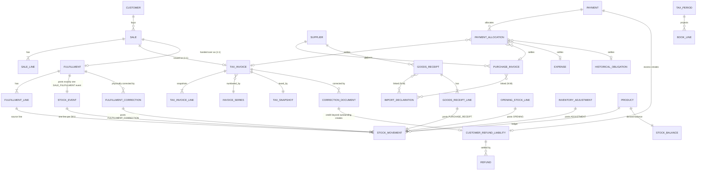

# AL STORE V7 — Domain Model

Status: Proposed (Phase 00). Physical table definitions, Drizzle schema and migrations are created in Phase 02; this document is the contract they must satisfy. Names are English (code); Albanian labels appear only in UI/docs output.

## 1. Modelling principles

1. **One event, one purpose.** A sale, an invoice, a physical delivery, a stock movement, a payment, an allocation, a refund, a tax snapshot, a correction and an audit event are different records. None is inferred from another's side effect.
2. **Legal documents are immutable once issued/posted.** Drafts are editable; issued documents change only through new linked documents.
3. **Three record classes are never mixed:**
   - *Draft* — editable, no legal number, no stock/tax/financial effect.
   - *Posted / issued* — legally or physically effective, immutable, numbered where required.
   - *Historical reference* — imported pre-cutover facts (opening stock, open legacy invoices); they never create new sales, tax-book entries or invoice numbers.
4. **Fixed-point everywhere.** Quantities `numeric(18,3)`, negotiated unit prices `numeric(18,3)`, money `numeric(18,2)`; intermediate products computed with Decimal.js and rounded only per the approved rounding policy (VG-03). No JS `number` for money or quantity.
5. **Two kinds of time.** `*_at timestamptz` = UTC instants set by the database clock. `document_date date` / `period_month` = Kosovo-local calendar values (IANA `Europe/Belgrade`, which covers Kosovo). For documents AL STORE issues (invoices, corrections, fulfillments) the date is set server-side and never trusted from the client; dates of third-party documents (supplier invoices, DUD, expenses) are user-entered and validated against cutover and period status (THREAT_MODEL T-13).
6. **Organization scoping.** Every business table carries `org_id` (FK) for isolation and future-proofing; only one organization exists. No multi-tenant features.
7. **Every posting has a source-event key** (`source_type`, `source_id`/`source_line_id`) unique per effect, so the same business event cannot post twice.
8. **Single currency EUR** in MVP. A `currency` column exists with a CHECK `= 'EUR'`.

## 2. Bounded modules (rules.md §5)

| Module | Owns entities |
|---|---|
| `auth-audit` | users, user_roles, approvals, audit_events, idempotency_keys |
| `settings` | organizations, org_settings, release_gates, cutover_plan |
| `parties` | customers, customer_verifications, suppliers |
| `catalog-inventory` | products, opening_stock_batches/lines, stock_movements, stock_balances, inventory_adjustments |
| `sales-invoicing` | sales, sale_lines, invoice_series, tax_invoices, tax_invoice_lines, fulfillments, fulfillment_lines, invoice_pdf_renders |
| `corrections` | correction_documents (+lines), fulfillment_corrections (+lines) |
| `purchasing-imports` | purchase_invoices (+lines), goods_receipts (+lines), import_declarations, import_declaration_links |
| `expenses` | expenses |
| `payments-debts` | payments, payment_allocations, payment_reversals, customer_refund_liabilities, refunds |
| `historical-migration` | import_batches, historical_obligations |
| `tax-reporting` | vat_rule_sets, vat_rules, tax_snapshots, tax_periods, tax_period_snapshots, book_lines (LB/LSH), exports, atk_template_provenance |
| `documents` | document_files, document_links |

Modules call each other only through server-side service interfaces; no module writes another module's tables directly except inside a documented cross-module command (see `DATABASE_TRANSACTION_BOUNDARIES.md`).

## 3. Entity catalogue

Legend: **PK** primary key (UUID v7 or bigint identity — decided in Phase 02), **U** unique, **CK** check constraint, **Imm** immutable after the named state.

### 3.1 Identity, approvals and audit

| Entity | Key fields | Rules |
|---|---|---|
| `users` | id = Supabase `auth.users.id`, display_name, status (INVITED/ACTIVE/DISABLED) | No public signup. Disabling revokes sessions (Supabase tokens remain valid until expiry — session check on sensitive operations, see THREAT_MODEL T-05). |
| `user_roles` | user_id U, role ∈ {DIRECTOR, ACCOUNTANT} | Exactly one role per user. Authorization reads this table, **never** `user_metadata`. |
| `approvals` | id, subject_type, subject_id, approval_kind, actor_id, actor_role, decided_at, decision (APPROVED/REJECTED/REVIEWED/INVALIDATED), comment, subject_hash | Generic approval record; specific four-eyes rules enforced per kind (ROLE_PERMISSION_MATRIX §3). |
| `audit_events` | id, org_id, occurred_at, actor_id, actor_role, action, entity_type, entity_id, request_id, idempotency_key, before_hash/after_hash, safe_details jsonb | Append-only (UPDATE/DELETE revoked + trigger). No secrets or full personal data in `safe_details`. |
| `idempotency_keys` | (org_id, actor_id, key) U, operation, request_hash, status, result_type, result_id, created_at | Inserted inside the business transaction; see DATABASE_TRANSACTION_BOUNDARIES §3. |

### 3.2 Settings and gates

| Entity | Key fields | Rules |
|---|---|---|
| `organizations` | id, legal_name, seller identifiers (fields per OLD-01, entered by owner in secure settings) | No hard-coded fiscal identity anywhere in code/tests. |
| `org_settings` | default_payment_term_days (=15), invoice_issuers (OWN-04), cash_rule_ref, timezone (`Europe/Belgrade`) | Protected; changes audited; some require accountant approval. |
| `release_gates` | gate_key U (VG-xx/RG-xx), status ∈ {NOT_STARTED, EVIDENCE_PENDING, APPROVED, FAILED, BLOCKED, REVOKED}, evidence document_ids, approved_by, approved_at | Issuance/export code checks gate rows **and** an environment kill switch; neither alone enables tax release. PG-xx phase gates are QA verdicts (PASS/FAIL/BLOCKED) in docs, not rows here. |
| `cutover_plan` | planned_cutover_date, last_excel_day, cutover_instant (timestamptz), status (DRAFT/LOCKED/EXECUTED), signed_by | One active plan. See LEGACY_CUTOVER_PLAN. |

### 3.3 Parties

| Entity | Key fields | Rules |
|---|---|---|
| `customers` | id, legal_name, identifiers per OLD-14 (e.g. business/fiscal/VAT numbers as approved), address, verification_state, active | **Registered businesses only.** No consumer fields. Duplicate-identifier warning. |
| `customer_verifications` | customer_id, method (FORMAT_CHECK / MANUAL_EVIDENCE / OFFICIAL_SOURCE), result, evidence document_id, verified_by, verified_at, valid_until? | `verification_state` derived: UNVERIFIED, FORMAT_VALID, MANUALLY_VERIFIED, OFFICIALLY_VERIFIED, SUSPENDED. Only states approved under VG-07 permit issuance. Format validity alone never permits issuance. "Officially verified" may only be shown if a trusted integration actually exists. |
| `suppliers` | id, legal_name, country ∈ {XK, AL}, identifiers, currency = EUR | A business that is both customer and supplier has two records linked by an optional `related_party_id` (OWN-14). |
| `identifier_format_rules` | identifier_type ∈ {BUSINESS_NUMBER, FISCAL_NUMBER, VAT_NUMBER}, required, digits_only, min/max length, source_note, status (ACTIVE/RETIRED) | Added in Phase 03. Written only by an ACTIVE ACCOUNTANT (P-15, DB trigger). Without an ACTIVE rule for every entered identifier no FORMAT_CHECK is recorded (no format validity claimed). |

### 3.4 Catalogue and inventory

| Entity | Key fields | Rules |
|---|---|---|
| `products` | id, sku U (immutable), name, category ∈ {ALUMINIUM, PVC, ACCESSORY, OTHER}, unit ∈ {KG, M2, COPE}, barcode?, reference_purchase_price numeric(18,3)?, active | Unit immutable after first stock movement (trigger). No variants, lengths, lots. `reference_purchase_price` is informational only — never used as tax base or valuation. Derived `stock_tracking_status ∈ {KNOWN, UNKNOWN}`: KNOWN if its posted opening line is VERIFIED_QTY/VERIFIED_ZERO, **or** it was created after the opening batch was POSTED (starts at 0.000, creation audited as "new SKU, nothing on hand"), **or** an approved OPENING_RESOLUTION adjustment exists. |
| `product_unit_changes` | product_id, from_unit, to_unit, reason, status (PENDING_APPROVAL/APPROVED_APPLIED/REJECTED/CANCELLED), requested_by, decided_by, decided_at, approval_id | Added in Phase 03: the only INV-05 exception. Four-eyes (P-14, DB CHECK); applied in the same transaction as the approval, only at on_hand 0.000 and with no open drafts; no quantity conversion. |
| `opening_stock_batches` | id, cutover_plan_id, status (DRAFT/COUNTED/RECONCILED/SIGNED_OFF/POSTED), counted_as_of = last Excel day, approvals | One POSTED batch per org in MVP (re-opening = new adjustment, not new opening). |
| `opening_stock_lines` | batch_id, product_id U-per-batch, status ∈ {VERIFIED_QTY, VERIFIED_ZERO, UNKNOWN}, quantity numeric(18,3) ≥ 0, count evidence | UNKNOWN → product's `stock_tracking_status` is UNKNOWN until an approved OPENING_RESOLUTION adjustment exists (INV-08). |
| `stock_events` | id, org_id, event_type, source_type, source_id, effective_at, document_date, posted_by | **Append-only.** One header per physical source event (one per fulfillment, receipt, opening line batch, adjustment, fulfillment correction). U(source_type, source_id). |
| `stock_movements` | id, stock_event_id, product_id, quantity_delta numeric(18,3) ≠ 0, unit (copied, must equal product unit), source_type and movement_type (denormalized from the event, immutable), source_line_id | **Append-only ledger lines.** U(source_type, source_line_id); partial U(product_id) WHERE movement_type = OPENING. Types and allowed sources in INVENTORY_INVARIANTS §2. |
| `stock_balances` | product_id PK, on_hand numeric(18,3) CK ≥ 0, last_movement_id, version | Exactly one row per product, inserted with on_hand 0.000 in the transaction that creates the product; posting commands lock existing rows only. Read model updated in the same transaction as each movement; reconcilable from the ledger. |
| `inventory_adjustments` | id, product_id, kind ∈ {COUNT_CORRECTION, DAMAGE_LOSS, EXCEPTIONAL_RETURN, OPENING_RESOLUTION}, quantity_delta, reason, evidence, status (DRAFT/PENDING_APPROVAL/APPROVED_POSTED/REJECTED) | Four-eyes: approver ≠ requester. Never created automatically by a financial document. |

### 3.5 Sales, invoices and fulfillment

| Entity | Key fields | Rules |
|---|---|---|
| `sales` | id, customer_id, status (DRAFT/CONFIRMED/DISCARDED), version (optimistic lock), payment_term_days, created_by, confirmed_at | The commercial agreement. Draft never touches stock. CONFIRMED only via the issue command; Imm after CONFIRMED. |
| `sale_lines` | sale_id, line_no, product_id, quantity numeric(18,3) > 0, unit, unit_price_net numeric(18,3) ≥ 0 | No discount field. Unit must equal product unit. |
| `invoice_series` | id, fiscal_year, code/prefix, kind ∈ {SALES_INVOICE, CORRECTION_DOCUMENT}, legacy_last_number, next_number, status (PROPOSED/ACCOUNTANT_APPROVED/ACTIVE/CLOSED), approval_id | Gapless counter; locked FOR UPDATE at issuance. U(fiscal_year, kind, code). Not a PostgreSQL SEQUENCE (sequences are not gapless). |
| `tax_invoices` | id, sale_id U, series_id, number, U(series_id, number), document_date, issued_at, issued_by, buyer snapshot, seller snapshot, totals (net, VAT, gross numeric(18,2)), due_date, tax_snapshot_id, legal_template_version | **Imm on insert** (trigger rejects UPDATE/DELETE). Payment status is derived, never stored on the invoice. |
| `tax_invoice_lines` | invoice_id, line_no, product snapshot (sku, name, unit), quantity, unit_price_net, line_net, vat_category, vat_rate snapshot, line_vat | Immutable copy, not a reference to mutable product data. |
| `fulfillments` | id, sale_id U, invoice_id U, delivered_at, document_date, handed_over_by, status = POSTED | The physical handover. Exactly one per sale in MVP. |
| `fulfillment_lines` | fulfillment_id, sale_line_id U, product_id, quantity | Each line posts one SALE_FULFILLMENT movement (source_line_id = fulfillment_line.id). |
| `invoice_pdf_renders` | invoice_id, render_no, template_version, storage_object, sha256, rendered_at | Many renders allowed; none changes business state. |

### 3.6 Corrections

| Entity | Key fields | Rules |
|---|---|---|
| `correction_documents` | id, kind ∈ {CREDIT, DEBIT, CORRECTION} (legal set per OLD-06), original_invoice_id, series_id, number, reason_code ∈ {QTY_WRONG, PRICE_WRONG, BUYER_DATA, OTHER}, reason_comment, status, totals, tax_snapshot_id, target_period | Own immutable identity and numbering after ISSUED. **Never posts stock.** |
| `correction_document_lines` | correction_id, original_invoice_line_id?, quantity_delta, price_delta, net/VAT deltas | — |
| `fulfillment_corrections` | id, fulfillment_id, linked_correction_document_id?, reason, status (DRAFT/PENDING_APPROVAL/APPROVED_POSTED/REJECTED) | Physical truth correction (e.g. invoiced 100 kg, handed over 10 kg → +90.000 kg back to stock). Four-eyes. |
| `fulfillment_correction_lines` | fulfillment_correction_id, fulfillment_line_id, quantity_delta | Posts FULFILLMENT_CORRECTION movement; cumulative corrections cannot make delivered quantity < 0. |

### 3.7 Purchasing and imports

| Entity | Key fields | Rules |
|---|---|---|
| `purchase_invoices` | id, supplier_id, supplier_invoice_number, invoice_date, received_doc_date, totals, status (DRAFT/REGISTERED), tax_classification_status (UNCLASSIFIED/PROPOSED/ACCOUNTANT_APPROVED), pre_cutover flag, attachment links | U(supplier_id, normalized supplier_invoice_number) + cross-module duplicate warning with expenses. **Never posts stock.** |
| `purchase_invoice_lines` | invoice_id, product_id, quantity, unit_price_net numeric(18,3), line totals | Purchase price stays exactly as invoiced; customs/transport never folded in. |
| `import_declarations` | id, customs_reference (DUD no.) U, declaration_date, broker supplier_id?, customs_value, duty/other customs amounts (fields per OLD-07), import_vat_amount, status, tax_classification_status, DUD attachment | Separate entity; linked N:M to purchase invoices and receipts via `import_declaration_links`. |
| `goods_receipts` | id, supplier_id, received_at, document_date, status (DRAFT/DISCREPANCY_HOLD/POSTED/REJECTED), covered_by_opening_count flag | Physical receipt — the **only** purchase-side stock source. |
| `goods_receipt_lines` | receipt_id, product_id, received_quantity, expected_quantity?, purchase_invoice_line_id?, discrepancy_note | Each POSTED line posts one PURCHASE_RECEIPT movement. Invoice can be linked later. |

### 3.8 Expenses

| Entity | Key fields | Rules |
|---|---|---|
| `expenses` | id, vendor (supplier_id or free-text business), reference, document_date, category ∈ {RENT, ELECTRICITY, TRANSPORT, SERVICES, OTHER}, net, vat_amount, gross, tax_classification_status, status (DRAFT/POSTED), attachments | **Never** stock, never fulfillment. Posted expense corrected via linked correction entry, not edit. |

### 3.9 Payments and debts

| Entity | Key fields | Rules |
|---|---|---|
| `payments` | id, direction ∈ {IN, OUT}, party (customer/supplier), method ∈ {CASH, BANK}, amount numeric(18,2) > 0, payment_date, bank_reference?, cash_rule_check snapshot, recorded_by | Immutable. Mistakes corrected by `payment_reversals` (approved). Bank reference duplicate warning/U per party. |
| `payment_allocations` | id, payment_id, target exactly one of {tax_invoice_id, correction_document_id (debit), purchase_invoice_id, expense_id, historical_obligation_id}, amount > 0 | CK exactly one target. Σ allocations on a target ≤ target outstanding (checked under lock). Σ allocations of a payment ≤ payment amount. |
| `customer_refund_liabilities` | id, customer_id, source_type ∈ {PAYMENT_OVERPAYMENT, CREDIT_AFTER_SETTLEMENT}, source_id, U(source_type, source_id), amount, status derived (OPEN/PARTIALLY_REFUNDED/SETTLED) | Created only by explicit user confirmation — of an overpayment (CMD-11) or of a credit that exceeds the invoice's outstanding (CMD-04); not revenue, not an automatic advance. |
| `refunds` | id, liability_id, payment_id (direction OUT), amount | Σ refunds ≤ liability. |
| `payment_reversals` | id, payment_id U, reason, approval_id | Reverses a mistaken payment record and its allocations; four-eyes. |
| `settlement_targets` | (target_type, target_id) PK, created_at | One **mutable lock row** per settlement target (issued invoice, issued debit document, purchase invoice, expense, historical obligation, refund liability), inserted in the same transaction as the target. Allocation, correction, refund and reversal commands lock these rows `FOR UPDATE`; the immutable documents are never row-locked (DATABASE_TRANSACTION_BOUNDARIES §4). |

Derived (never stored as SoT): invoice outstanding = gross + Σ issued debit deltas − Σ issued credit deltas − Σ allocations + Σ CREDIT_AFTER_SETTLEMENT liabilities created from credits on this invoice, never < 0 (the part of a credit beyond outstanding becomes an explicit refund liability, CMD-04); due date and aging buckets; customer/supplier statements.

### 3.10 Historical migration

| Entity | Key fields | Rules |
|---|---|---|
| `import_batch_rows` | batch_id, row_no U, raw, status (VALID/WARNING/ERROR), issues, parsed, product_id | Staged rows of a dry run (Phase 04); frozen once the batch is decided. |
| `import_batches` | id, kind ∈ {PRODUCTS, OPENING_STOCK, HISTORICAL_RECEIVABLES, HISTORICAL_PAYABLES}, file sha256, status (UPLOADED/VALIDATED/HAS_ERRORS/PENDING_APPROVAL/APPROVED/REJECTED), row counts, approvals | Dry run before approval; all-or-nothing by default. |
| `historical_obligations` | id, direction ∈ {RECEIVABLE, PAYABLE}, party_id, original_series, original_number, original_issue_date, original_total?, open_balance_at_import numeric(18,2), batch_id, status (STAGED/APPROVED/REJECTED) | U(direction, party, normalized original series+number). **Never** a tax invoice, stock movement, sale, expense or book line. Only APPROVED records accept allocations. |

### 3.11 Tax and reporting

| Entity | Key fields | Rules |
|---|---|---|
| `vat_rule_sets` / `vat_rules` | category code, applies_to (SALE/PURCHASE/IMPORT/EXPENSE), rate or treatment, effective_from/to, status (DRAFT/ACCOUNTANT_APPROVED/ACTIVE/SUPERSEDED), approval | No rate or treatment is seeded by developers; all values entered and approved by the accountant (VG-02). Missing/unapproved rule → posting blocked. |
| `tax_snapshots` | id, rule ids + values, rounding policy version, computation trace, hash | Immutable; attached to every issued/posted tax-relevant document. |
| `tax_periods` | id, period_month U, status (see FINANCIAL_DOCUMENT_STATES §10), current_snapshot_id | — |
| `tax_period_snapshots` | id, period_id, kind (ACCOUNTANT_REVIEW / DIRECTOR_APPROVAL / CLOSE / AMENDMENT), content hash, totals | Approval bound to hash; any change invalidates. |
| `book_lines` | period_id, book ∈ {LB, LSH}, source_type, source_id, U(book, source_type, source_id, version) | Projection from approved posted documents only. Historical obligations, payments, stock movements, PDFs are **never** sources. |
| `exports` | id, period_id, kind ∈ {INTERNAL_PREVIEW, OFFICIAL}, template_provenance_id?, file sha256, generated_by | OFFICIAL impossible unless VG-12 APPROVED. Preview labeled "JO PËR DORËZIM". |
| `atk_template_provenance` | url, retrieved_at, file sha256, version label, mapping doc, accountant approval | Phase 15. |
| `edi_filing_receipts` | period_id, filed_on, receipt reference, evidence document, recorded_by | Manual record of a filing done by the owner outside the app. |

### 3.12 Documents

| Entity | Key fields | Rules |
|---|---|---|
| `document_files` | id, storage bucket/object path, sha256, mime, size, uploaded_by, status (QUARANTINE/LINKED/ORPHANED) | Private bucket; access only through server authorization. |
| `document_links` | document_id, entity_type, entity_id, role (SUPPLIER_INVOICE, DUD, VERIFICATION_EVIDENCE, COUNT_SHEET, EXPENSE_EVIDENCE, FILING_RECEIPT, …) | Supplier invoice and DUD are separate files with separate roles, linked to the same import. |

## 4. Relationship overview

Note what is **absent** by design: no edge from payment, correction document, expense, purchase invoice, PDF, export or historical obligation to `STOCK_MOVEMENT`.

## 5. Spec-required separations — checklist

| Spec pair that must stay separate | Where enforced |
|---|---|
| Sale ↔ tax invoice ↔ physical delivery | Three tables; one atomic command creates all three (CMD-02) |
| Purchase invoice ↔ stock receipt | Separate tables; only receipt posts stock |
| Supplier invoice ↔ DUD | Separate entities and separate document files |
| Purchase price ↔ customs/import VAT | Separate fields; no folding into product price |
| Credit/debit note ↔ stock correction | Separate tables; credit never posts stock |
| Payment ↔ allocation ↔ refund liability ↔ refund | Four tables |
| Opening stock ↔ purchase receipt | Different movement types and sources |
| Historical obligation ↔ tax invoice | Different tables; historical never in books or numbering |
| Expense ↔ inventory | No FK path to stock |
| Tax books ↔ stock/payments/PDFs | Book projection sources whitelist |
