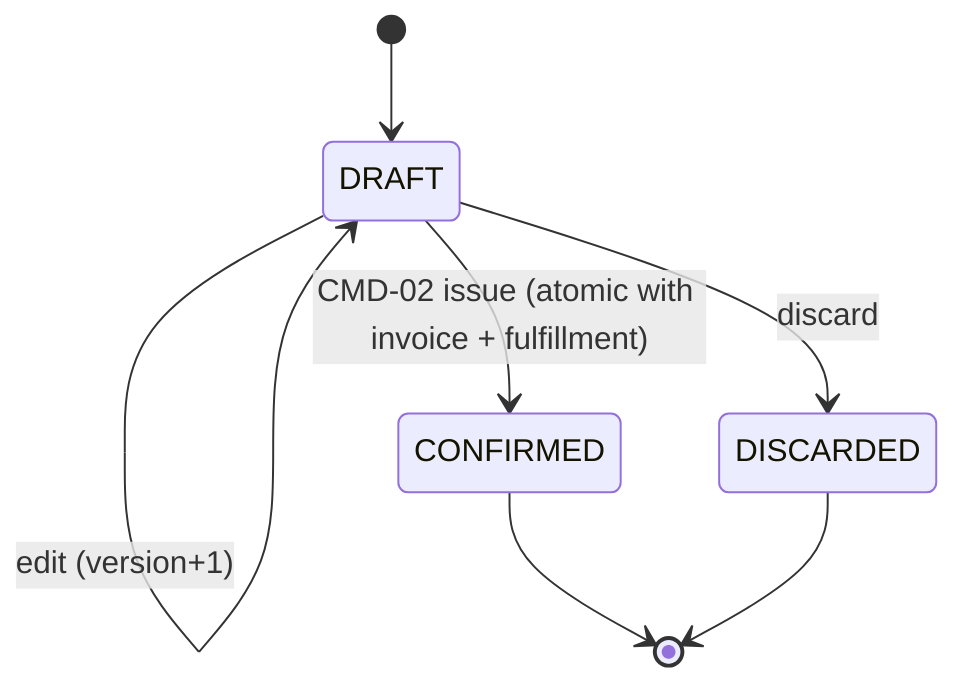
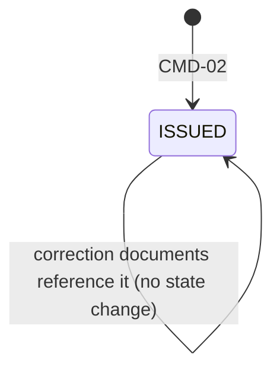
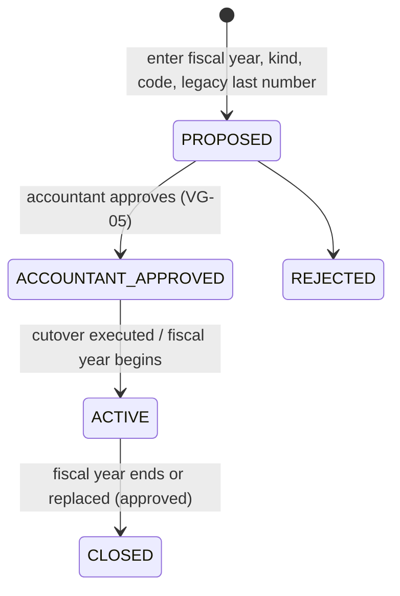
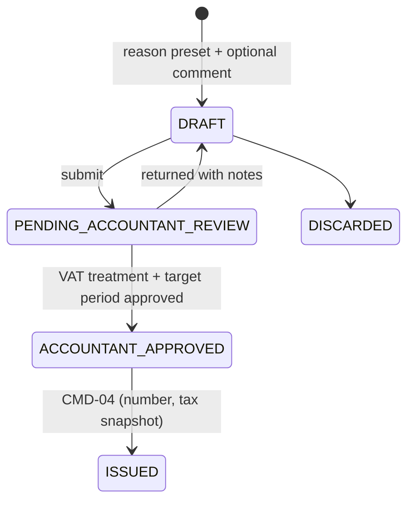
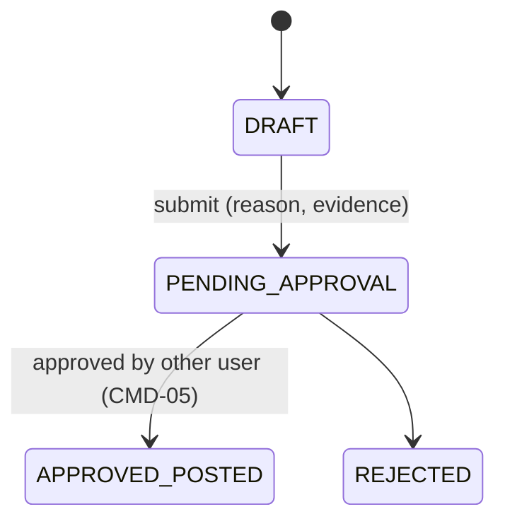
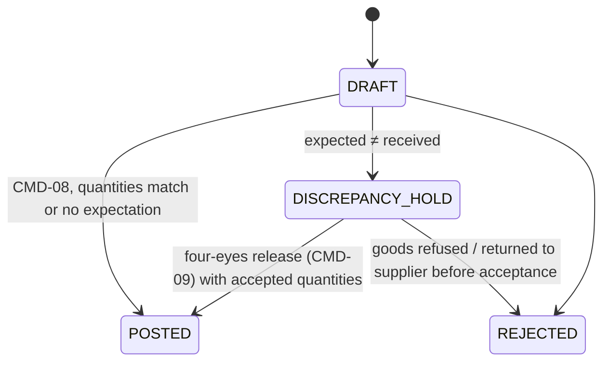
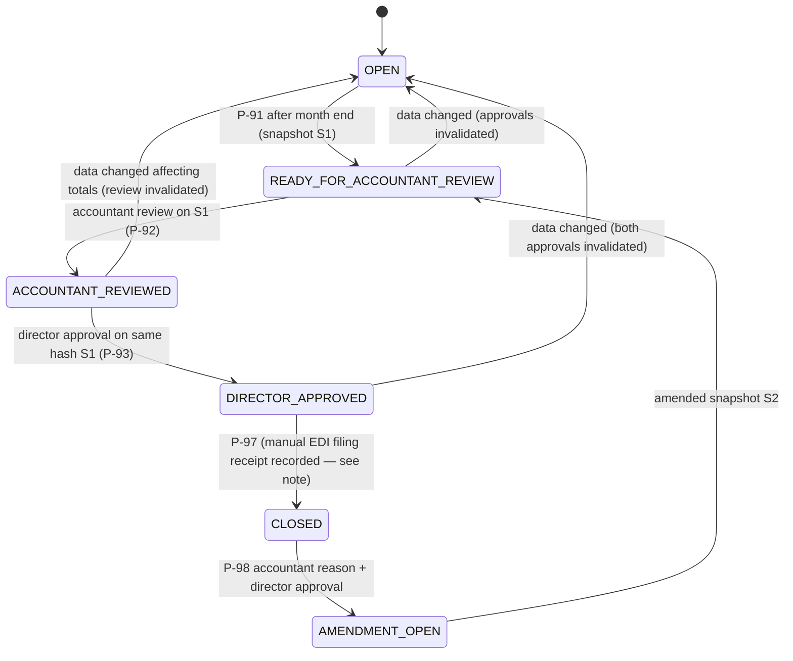

# AL STORE V7 — Financial Document States

Status: Proposed (Phase 00). Legal names and permissible transitions for correction documents, period amendments and cancellations depend on OPEN_LEGAL_DECISIONS (OLD-05, OLD-06, OLD-12); where marked **[legal]**, the state machine is the safe structural default and the accountant must confirm before the release gate passes.

## 1. Rules common to every document

1. **Draft** states are editable, carry no legal number, and have no stock, tax-book or receivable effect.
2. **Issued / posted** states are immutable (DB trigger + revoked UPDATE). Corrections are new linked documents; nothing is deleted (rules.md DB rule 9).
3. Every transition is a server command (DATABASE_TRANSACTION_BOUNDARIES §5), is permission-checked (ROLE_PERMISSION_MATRIX), writes an audit event, and — for irreversible transitions — requires an idempotency key and an explicit confirmation screen.
4. "Status" columns that can be computed (paid/unpaid, refunded, outstanding) are **derived**, never stored as the source of truth.
5. There is no VOID/CANCELLED state for issued legal documents in MVP. Whether cancellation of an issued invoice is ever legally permissible is OLD-05 **[legal]**.

## 2. Sale

- CONFIRMED is reachable **only** through CMD-02; there is no "confirmed but not invoiced" or "invoiced but not delivered" state in V7 (immediate handover, one invoice per sale).

## 3. B2B tax invoice

- Single persistent state `ISSUED`. Derived views: payment status (UNPAID / PARTIALLY_PAID / PAID / OVERDUE from due date), correction chain (has credit/debit/correction documents), PDF availability (READY / PENDING_RENDER).
- Preview of a draft is never an invoice: no number, watermark "PARAPAMJE – JO FATURË" (exact wording to be reviewed in Phase 07).

## 4. Invoice series

- `next_number` starts at `legacy_last_number + 1` only if the accountant approves continuation; otherwise as approved. **[legal]** OLD-05.
- Separate series kind for correction documents if required. **[legal]** OLD-06.
- An ACTIVE series for year Y+1 must be approved before 1 January (cutover runbook).

## 5. Correction document (credit / debit / correction)

- ISSUED is immutable, numbered, references the original invoice, and never posts stock.
- Original invoice already paid / partially paid: credit reduces outstanding; if it would push outstanding below zero, CMD-04 requires explicit `excess_action = CREATE_REFUND_LIABILITY` (liability `source_type = CREDIT_AFTER_SETTLEMENT`) or rejects with `CREDIT_EXCEEDS_OUTSTANDING`. **[legal]** OLD-06, OLD-15.
- Original invoice in a CLOSED period: target period chosen by accountant per OLD-12 **[legal]**.

## 6. Fulfillment (physical) correction

- Independent of any correction document; may be linked to one for traceability.

## 7. Purchase invoice and import declaration (two independent axes)

| Axis | States |
|---|---|
| Record lifecycle | DRAFT → REGISTERED (immutable core fields; corrections via linked supplier credit/debit records) |
| Tax classification | UNCLASSIFIED → PROPOSED → ACCOUNTANT_APPROVED (→ RECLASSIFICATION_PENDING → ACCOUNTANT_APPROVED, only if period still OPEN; otherwise amendment) |

- Only REGISTERED + ACCOUNTANT_APPROVED records feed LB.
- Import declaration (DUD) follows the same two axes; LB source rule (supplier invoice vs DUD vs both, per field) is OLD-07 **[legal]** and is mapped so the same acquisition is never counted twice.
- Neither ever posts stock.

## 8. Goods receipt

- POSTED is immutable; later errors → inventory adjustment (approved), never edit.

## 9. Expense

DRAFT → POSTED (immutable) ; tax classification axis as §7; correction via linked correction entry (DRAFT → POSTED) referencing the original. Never stock.

## 10. Tax period (monthly VAT, LB/LSH)

- Accountant review and director approval are separate approval rows bound to the **same snapshot hash**, by **different users** (SOD-1). The director cannot record the accountant review (SOD-2).
- Whether CLOSED requires a recorded EDI filing receipt first, and how amendments to filed months must be declared, are OLD-12 **[legal]**. Default: CLOSED requires the filing receipt.
- The first AL STORE period is the cutover month; the month before is handled entirely in the legacy process (LEGACY_CUTOVER_PLAN §4).

## 11. Payments, allocations, refund liabilities, refunds

| Record | States |
|---|---|
| Payment | RECORDED (immutable). Derived: FULLY_ALLOCATED / PARTIALLY_ALLOCATED / HAS_REFUND_LIABILITY. Cash records may carry `accountant_confirmation_required` until VG-11 → ACCOUNTANT_CONFIRMED. |
| Payment reversal | PENDING_APPROVAL → APPROVED_POSTED (reverses payment + its allocations) / REJECTED |
| Allocation | ACTIVE (immutable); reversed only through payment reversal |
| Customer refund liability | Derived from refunds: OPEN → PARTIALLY_REFUNDED → SETTLED |
| Refund | RECORDED (immutable), outgoing payment linked to liability |

## 12. Imports and historical obligations

| Record | States |
|---|---|
| Import batch | UPLOADED → VALIDATED / HAS_ERRORS → PENDING_APPROVAL → APPROVED / REJECTED. Historical batches: accountant validation then director approval (OWN-06). |
| Historical obligation | STAGED → APPROVED / REJECTED. Derived balance: OPEN / PARTIALLY_SETTLED / SETTLED. Never a tax invoice, never in books, never in numbering. |
| Opening stock batch | DRAFT → COUNTED → RECONCILED (accountant) → SIGNED_OFF (director) → POSTED (CMD-14). |

## 13. VAT rule set

DRAFT → ACCOUNTANT_APPROVED → ACTIVE (effective-dated) → SUPERSEDED. A rule that has been snapshotted onto a posted document is never edited; a change creates a new version with a new effective range.

## 14. Exports

| Kind | States |
|---|---|
| INTERNAL_PREVIEW | GENERATED (always labeled "JO PËR DORËZIM") |
| OFFICIAL | Not creatable unless VG-12 APPROVED **and** period DIRECTOR_APPROVED; then GENERATED with template provenance id and file hash. UI otherwise shows "Eksporti ATK është në pritje të verifikimit". |

## 15. Release gates

Enum (shared with RELEASE_GATES and the `release_gates` table): NOT_STARTED, EVIDENCE_PENDING, APPROVED, FAILED, BLOCKED, REVOKED. Flow: NOT_STARTED → EVIDENCE_PENDING → APPROVED (or FAILED) → (REVOKED → EVIDENCE_PENDING). BLOCKED marks a gate that cannot progress until an external dependency is resolved. Revocation immediately disables the dependent feature.

## 16. Accountant review → director final approval — end-to-end

1. Month M ends; late supplier documents may still arrive (OLD-12 decides their period).
2. Either user marks M READY_FOR_ACCOUNTANT_REVIEW → system freezes snapshot S1 (LB lines, LSH lines, VAT reconciliation, flags: duplicates, missing identifiers, inconsistent VAT, late adjustments).
3. Accountant inspects, resolves flags (each fix returns M to OPEN and requires a new snapshot), then records **ACCOUNTANT_REVIEWED** on hash S1 with comment.
4. Director sees the accountant's review and comment; records **DIRECTOR_APPROVED** on the same hash. Director cannot approve a hash the accountant has not reviewed.
5. Internal preview "JO PËR DORËZIM" always available; OFFICIAL export only if VG-12 approved.
6. Owner files in EDI **outside the app**; the app never logs into ATK.
7. Filing receipt recorded with evidence → CLOSED.
8. Later corrections: amendment flow (§10) — never a silent change to a closed month.
