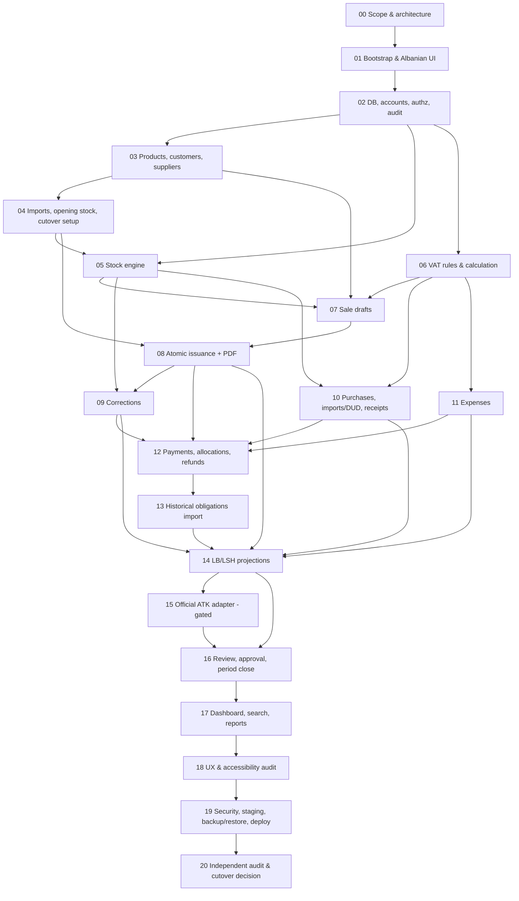

# AL STORE V7 — Phase Dependencies

Status: Proposed (Phase 00).

**Execution rule (spec §B, §C):** phases are executed **one at a time in numeric order**, each followed by the independent QA prompt. A phase may start only when every phase it depends on — and the immediately preceding phase — has a `docs/QA_PHASE_XX.md` verdict of **PASS**. The dependency graph below explains *why* the order matters and what a regression in one phase invalidates; it does not authorize parallel execution.

## 1. Graph

## 2. Table

| Phase | Depends on (hard) | Produces for later phases | External gates touched |
|---|---|---|---|
| 00 | — | All architecture docs, ADR-001, gates, permission matrix | RG-00, RG-01 identified |
| 01 | 00 | App shell, design system, lint/type/test/E2E tooling (Playwright), env validation | — |
| 02 | 01 | Drizzle schema & migrations for all entities, auth, roles, audit, idempotency, RLS/defense | OWN-08 (env project) |
| 03 | 02 | Products, customers (verification states), suppliers | VG-07 (procedure needed before issuance, not before CRUD) |
| 04 | 03 | Import pipeline, opening stock batches, cutover plan, last legacy number capture | OWN-02, OWN-03, OWN-05 |
| 05 | 02, 04 | Stock ledger, balances, adjustments, reconciliation, concurrency harness | — |
| 06 | 02 | VAT rule engine, snapshots, rounding, gate checks | VG-02, VG-03, VG-04 (engine works with synthetic approved rules; real rules await accountant) |
| 07 | 03, 05, 06 | Sale drafts, final review | — |
| 08 | 04, 07 | CMD-02 issuance, numbering, fulfillment, PDF | VG-01, VG-05, VG-06, VG-14, VG-17 (real issuance) |
| 09 | 05, 08 | Correction documents, fulfillment corrections | VG-08 |
| 10 | 05, 06 | Purchase invoices, DUD, receipts, discrepancies | VG-09 |
| 11 | 06 | Expenses | VG-10 |
| 12 | 08, 09, 10, 11 | Payments, allocations, refund liabilities, refunds, aging | VG-11, VG-16 |
| 13 | 12 (+03) | Historical obligations import & progress view | OWN-06, OWN-09 |
| 14 | 08, 09, 10, 11, 13 | LB/LSH projections (must prove historical records are excluded) | VG-04, VG-09, VG-10 |
| 15 | 14 | Official adapter (disabled until verified) | VG-12 |
| 16 | 14, 15 | Period lifecycle, SOD approvals, amendments | VG-13 |
| 17 | 16 (all data modules) | Dashboard, search, reports | — |
| 18 | 17 | UX/a11y fixes | — |
| 19 | 18 | Hardened, deployed staging/prod, tested restore | VG-15, VG-18, OWN-13 |
| 20 | 19 | Release audit, cutover runbook, go/no-go | All |

## 3. Go-live scope vs build scope

- **Built before go-live:** phases 00–20 (Phase 20 audit tests historical import after live start, so Phase 13 must be built).
- **Data required before first real sale:** approved products, posted opening stock, approved series, verified customers, all issuance gates.
- **Data allowed after go-live:** historical receivables/payables batches (A.11), additional customers/products.

## 4. Regression propagation

If a later phase changes a contract owned by an earlier phase (schema, command, invariant), the earlier phase's tests must be re-run and the change recorded in the later phase's `PHASE_XX.md`. Changes to `INVENTORY_INVARIANTS.md`, `DATABASE_TRANSACTION_BOUNDARIES.md` or `ROLE_PERMISSION_MATRIX.md` require a note in the next QA report.
